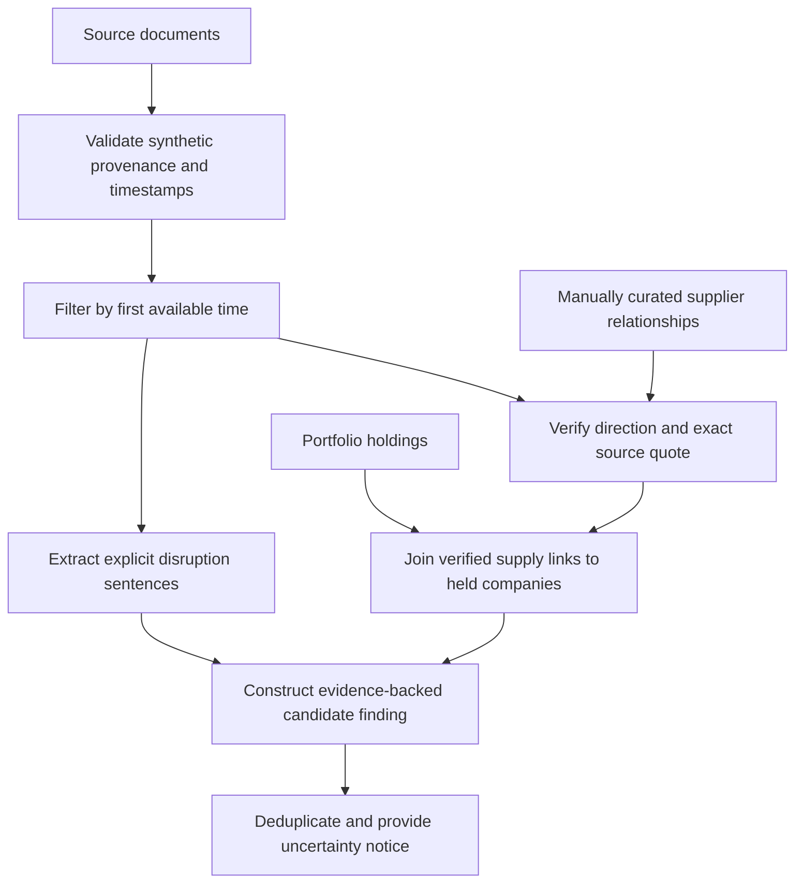

# Research engine: technical design and review notes

## Purpose

The first objective is to determine whether a documented operational event can be connected to a held company through a defensible, time-valid supplier relationship. Every asserted path must be reconstructible from the evidence available at the requested cutoff.

The present implementation is a deterministic reference baseline, not a substitute for document intelligence or entity resolution.

## Current data flow

The process is a lead-generation workflow for review. Even a verified relationship and a real disruption would not establish economic materiality without additional evidence.

## Evidence contract

Document IDs must be unique. Document metadata includes publication and first availability times. Both times require an explicit UTC offset and availability cannot precede publication. The current fixture loader accepts only `synthetic_example` documents with `synthetic://` source references.

A citation includes its document ID, exact quote, start and end offsets, title, timestamps, source reference and SHA-256 fingerprint of the text. Quotes absent from the source, empty quotes and ambiguous repeated quotes are rejected.

A candidate supplier statement must identify both companies, assert a supply direction supported by a narrow syntactic rule, and avoid obvious negation or conditional language. This rejects many genuine statements, which is preferable to inventing an unsupported relationship at the research stage.

Event detection uses a limited set of disruption verbs and rejects sentences containing common signals of negation, hypotheticals, plans and uncertainty. The classifier is intentionally conservative. It can miss true events and still misread complex syntax. It is not a semantic validation model.

A finding ID is stable for the same company, supplier, document and event sentence. Multiple identical relationships do not produce repeated alerts. If independently documented relationships produce the same finding, a deterministic input ordering selects the first citation; a future version should retain all independent supporting sources rather than discard them.

## Evaluation boundaries

Automated unit tests cover timestamp handling, rejection of unsourced claims, relationship direction, basic negation, duplicate records, deterministic replay and citation offsets. `evaluate_baseline.py` checks a hand-authored set of synthetic examples. Results on that dataset are regression evidence only. They cannot support an external claim about precision, recall, real-world reliability or financial usefulness.

Before real-data demonstrations, construct a held-out annotation set with actual source quotations. Record reviewer identity, labeling guidance, document dates, first availability times, exposure relevance and disagreement. Report precision, recall, false positives per portfolio and abstentions with confidence intervals where sample size permits. Compare a keyword baseline, rule-based extraction and NLP model under the same cases. Avoid leakage across documents, companies and event periods.

## Recommended implementation sequence

Develop source adapters with explicit rights checks and fair-access compliance. Preserve source bytes, retrieval metadata, content hash and version history. Introduce validated entity identifiers and a reviewable claim ledger. Extend extraction using NLP after a labeled evaluation set exists. Only then expose documented read-only APIs and a dashboard. Prediction-market contract clauses should share the underlying source and time model, while keeping contract identity and settlement semantics distinct from portfolio exposure links.

No historical test should use knowledge introduced after its `as_of` cutoff. A local run with synthetic examples does not validate that a production timestamp represents the first instant a real institution could access a source.
